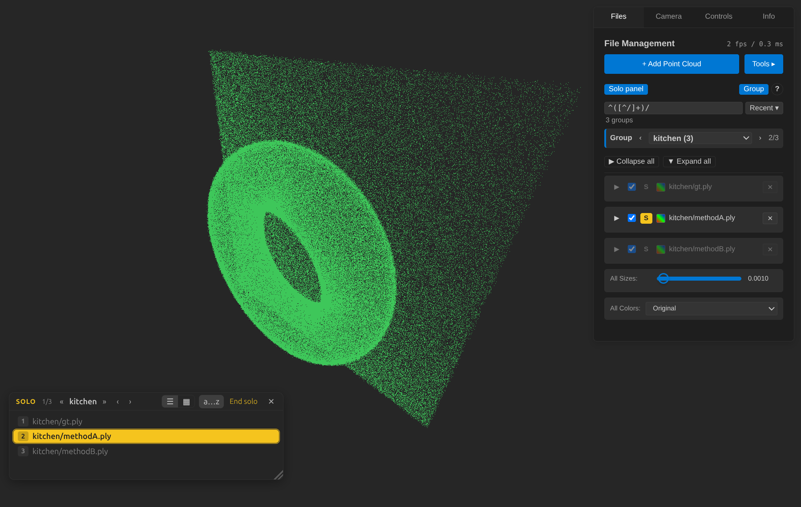

# 3D Visualizer — desktop fork

> **This is a fork of
> [kleinicke/ply-visualizer](https://github.com/kleinicke/ply-visualizer),
> produced with [Claude](https://claude.com/claude-code).** It aims to be
> primarily a **standalone desktop app** (Linux, Windows, macOS) built on the
> original's viewer engine, rather than a VS Code extension. The original
> project's README continues [below](#3d-visualizer).

## What this fork adds

- **Standalone desktop app** (Electron, `apps/electron/`): the same Chromium
  renderer as the VS Code webview, so the same speed, without an editor. Native
  File menu (Open Files/Folder, Open Recent, Add Files/Folder, Clear Scene, New
  Window), drag and drop of files and folders, command line
  (`ply-visualizer a.ply some/folder`), every launch its own window. Website
  analytics and links are stripped from the desktop build.
- **DAW-style solo**: an `S` button per file and `1`–`9` keys show only that
  file; `Shift`/`Ctrl` adds to the solo set, `↑`/`↓` or `[`/`]` step through,
  `0`/`Esc` ends it. Solo never touches a file's own visibility checkbox, which
  comes back when solo ends.
- **Solo panel**: a floating, draggable, resizable list (or tile grid) of the
  files, hideable from the View menu or the file list. Optional smart name
  shortening collapses the parts every name shares (`…noise=0.01_seed=7`),
  keeping `key=` when the value differs; the full name is always on hover.
- **Groups**: a regular expression's capture group splits the open files into
  groups, and one group at a time is listed and drawn. `←`/`→` switch groups;
  the solo follows the file with the same name outside the captured part (e.g.
  `kitchen/methodA` → `office/methodA`), and each group remembers its own
  camera. Recent patterns and presets are one click away, with built-in help.
- **Folders as groups**: opening a folder names files by their path inside it,
  so grouping by subfolder is just the `^([^/]+)/` pattern (OS separator); a
  folder with no files at its top level offers exactly that.
- **Viewer UI**: the side panel resizes from its edges, the file list is no
  longer height-capped, and Collapse all / Expand all buttons sit under the
  group controls. UI drags never move the 3D view.

See [apps/electron/README.md](apps/electron/README.md) for building and the full
list of shortcuts.

---

# 3D Visualizer

View, compare and inspect point clouds, meshes, gaussian splats, depth maps and
disparity images in your editor or browser — with Rust and WebAssembly doing the
heavy decoding, so files with millions of points open in seconds.

## Highlights

- Open large point clouds quickly, including files with millions of points
- Decode the demanding formats in Rust/WebAssembly — LAS, LAZ, E57 and TIFF —
  alongside Rust geometry kernels for camera models and scan registration
- Compare multiple point clouds in one view and toggle them independently
- Convert depth and disparity images into point clouds
- Render gaussian splat reconstructions as sorted splats or center point clouds
- Inspect meshes as surfaces, wireframes, points and normals
- Use Eye-Dome Lighting and brightness correction for clearer uncolored geometry
- Measure distances and adjust camera, rotation center and view parameters
- Use the shared viewer on the [website](https://3d.f-kleinicke.de)
- Try the local
  [Python package and command-line viewer](packages/python/README.md) for 3D
  files, NumPy/PyTorch arrays and inline local notebooks
  (`uv add 3d-visualizer`)
- Connect AI agents through the [local MCP server](packages/python/MCP.md) to
  open scenes, control the camera and inspect rendered screenshots

## Supported formats

| Type                   | Formats                                                                                        |
| ---------------------- | ---------------------------------------------------------------------------------------------- |
| Point clouds           | PLY, XYZ, XYZN, XYZRGB, PCD, PTS, NPY, LAS, LAZ, E57, KITTI BIN, Stonex X3A/X3R (experimental) |
| Meshes                 | PLY, OBJ, STL, OFF, GLTF, GLB, FBX, DAE (Collada), 3DS                                         |
| Gaussian splats        | 3DGS PLY, SPZ, SPLAT, KSPLAT, SOG                                                              |
| Depth/disparity images | TIFF, PNG, PFM, NPY, NPZ                                                                       |
| 3D Body Poses          | JSON pose data (experimental)                                                                  |
| Camera Profiles        | JSON pose data (experimental)                                                                  |

Model animation playback and remote URL loading are supported; see
[model details](docs/models-and-animations.md) and
[remote files](docs/remote-files.md).

Because `.bin` and `.json` are generic extensions, neither is opened with the 3D
Visualizer by default. For KITTI BIN, use **Open With...** or right-click and
choose **Open with 3D Visualizer**. For a supported JSON pose, right-click and
choose **Load JSON as 3D Pose**.

## Features

### Depth and Disparity to Point Cloud

Convert depth or disparity images into point clouds. Projection settings include
`fx`, `fy`, `cx`, `cy`, camera distortion models, mono depth scale and bias, PNG
int16 scale and disparity offset.

### Eye-Dome Lighting

Use Eye-Dome Lighting to improve depth perception, especially for uncolored
point clouds.

### Multiple Point Clouds

Load multiple point clouds into the same view, toggle them independently and
switch between them with Shift-click.

### Mesh Inspection

Inspect mesh files with controls for surface, wireframe, points and normals.
This is useful when checking geometry, topology or exported reconstruction
results without leaving the editor.

### Gaussian Splatting

Open 3D Gaussian Splatting reconstructions (3DGS PLY, SPZ, SPLAT, KSPLAT, SOG)
and render them as real sorted splats via [Spark](https://sparkjs.dev), or as a
point cloud of the gaussian centers with colors derived from the
spherical-harmonics coefficients. Switch per file with the **✨ Splats** button
in the Files panel. Measurement and picking keep working on the gaussian centers
in splat mode. Oversized background gaussians can be reduced with the
logarithmic **Max splat size** control, while coloring center points by the
`opacity` scalar field in Points mode helps with spotting floaters.

### Point Cloud Attributes

Point cloud files can include positions, RGB colors, normals and scalar fields.
The viewer uses positions for geometry, original RGB values when available,
normals for inspection, and intensity/reflectivity fields for optional scalar
coloring. The recognized property names are `x/y/z`, `red/green/blue`,
`nx/ny/nz` and `intensity`/`reflectivity`/`reflectance`/`remission`. Any other
numeric per-vertex PLY property (e.g. `confidence`, `error`, `curvature`) also
appears in the Color dropdown for Viridis or grayscale colormap coloring.
LAS/LAZ attributes such as classification, returns, scan angle and GPS time are
exposed through the same scalar-field color controls. E57 containers load each
scan as a separate, independently visible entry.

### Distance Measurement Tools and Camera Manipulation

Build multiple measurement paths with **Shift-double-click**. See control
settings for options.

### Camera Recording

Create smooth camera paths from keyframes and export them as configurable video
recordings.

### Navigation

**Double-click** a point to change the rotation center. This allows for easy
navigation using a mouse or a trackpad. You can also manually enter the camera
position, rotation center and viewing angle.

### Performance-Aware Rendering

The viewer shows the current frame rate. When the point cloud is not moving, no
more frames are generated, which helps reduce power usage.

## NPY file structure options

- As a depth image: `[X,Y]`
- As a point cloud: `[...,3]` with the three values `X,Y,Z`

## Feature requests and issues

If you have a workflow that would benefit from new features or file formats,
please open an issue on the
[GitHub repository](https://github.com/kleinicke/ply-visualizer/issues). Example
files are especially helpful when adding support for new formats.

## Roadmap

- Add support for more file formats
- Improve dataset support with example images from Middlebury stereo and ETH3D
- Use calibration files next to depth images automatically when available
  (example files needed)
- Accept 3d body pose files (example files needed)

## Links

- **VS Code Marketplace:**
  [Install extension](https://marketplace.visualstudio.com/items?itemName=kleinicke.ply-visualizer)
- **Open VSX:**
  [Install extension](https://open-vsx.org/extension/kleinicke/ply-visualizer)
- **JetBrains:** [Signed preview and installation](jetbrains/README.md)
- **Website:** [3d.f-kleinicke.de](https://3d.f-kleinicke.de/)
- **Documentation:** [User guides and MCP reference](docs/README.md)
- **Standalone app:** [Tauri desktop preview](apps/desktop/README.md)
- **PyPI (Python and CLI):**
  [3d-visualizer](https://pypi.org/project/3d-visualizer/)
- **MCP:** Supported — [Agent setup and usage](packages/python/MCP.md)
- **More platforms:** Coming soon
- **Blog:** Coming soon
- **Videos:** Coming soon
